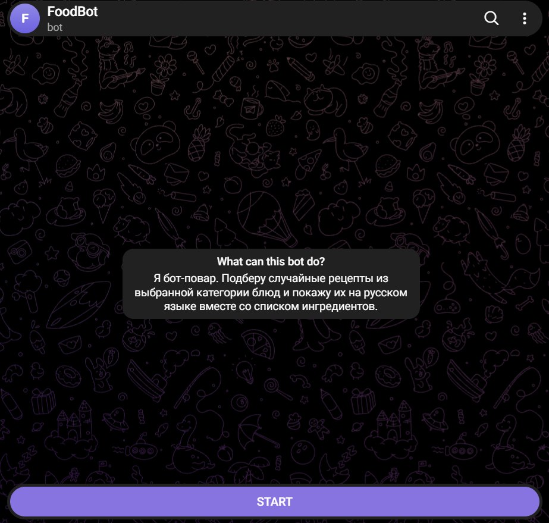
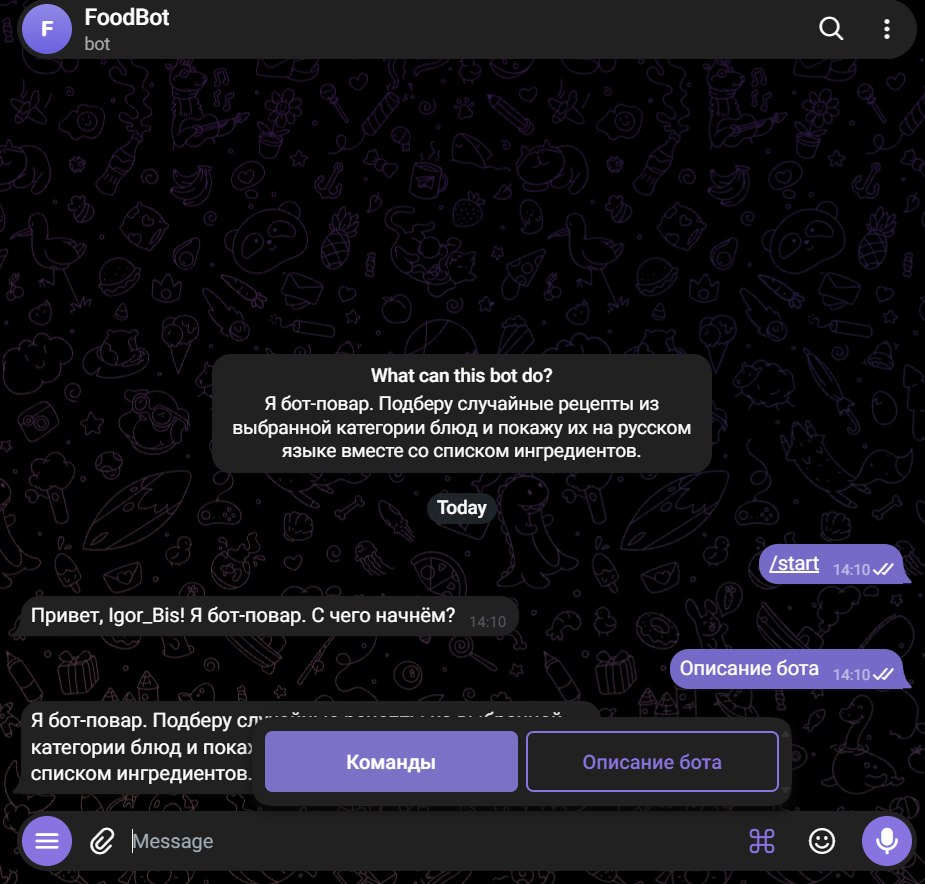
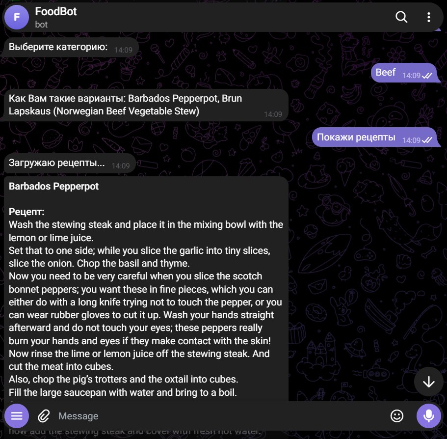

# FoodBot — Telegram Recipe Bot

**English** | [Русский](README.ru.md)

An asynchronous Telegram bot that picks random recipes from a chosen meal category, translates them into Russian and sends them with a list of ingredients.

Recipe data comes from the open [TheMealDB](https://www.themealdb.com/api.php) API.

## Demo

<p align="center">
  
  
  
</p>

## Features

- Random recipe search by category: `/category_search_random <count>`
- Categories are loaded from the API and shown as keyboard buttons
- Recipes are selected without repeats
- Concurrent recipe loading with `asyncio.gather`
- Translation of titles, instructions and ingredients into Russian
- Long recipes are split into several messages to fit Telegram's limit
- Search can be cancelled at any step with `/cancel`
- Command menu and bot description in the Telegram profile

## Tech stack

- Python 3.12+
- [aiogram 3](https://docs.aiogram.dev/) — Telegram bot framework
- [aiohttp](https://docs.aiohttp.org/) — asynchronous HTTP requests
- [googletrans](https://pypi.org/project/googletrans/) — text translation
- [python-dotenv](https://pypi.org/project/python-dotenv/) — loading settings from `.env`

## Project structure

```
├── bot_main.py         # Entry point: bot startup, /start, command menu
├── recipes_handler.py  # Recipe search dialog (three-step FSM)
├── mealdb_api.py       # Asynchronous TheMealDB API client
├── translation.py      # Asynchronous translation with a concurrency limit
├── token_data.py       # Loads the bot token from environment variables
├── docs/               # Screenshots for README
├── .env.example        # Settings template
└── requirements.txt    # Dependencies
```

## Installation and running

1. Clone the repository:

```bash
   git clone https://github.com/R00tPengu1n/TG_foodBot.git
   cd TG_foodBot
```

2. Create and activate a virtual environment:

```bash
   python -m venv .venv
```

   Windows:

```bash
   .venv\Scripts\activate
```

   Linux / macOS:

```bash
   source .venv/bin/activate
```

3. Install dependencies:

```bash
   pip install -r requirements.txt
```

4. Create a `.env` file based on `.env.example` and set the bot token from [@BotFather](https://t.me/BotFather):

```
   BOT_TOKEN=your_telegram_bot_token
```

5. Run the bot:

```bash
   python bot_main.py
```

## Usage

1. Send `/category_search_random 3` to the bot, where `3` is the number of recipes (1 to 10).
2. Choose a category using the buttons.
3. The bot suggests dishes — press «Покажи рецепты» ("Show recipes").
4. Each recipe arrives as a separate message: title, instructions and ingredients.

## Technical decisions

- **Finite state machine (FSM).** The search dialog is built on aiogram's `FSMContext`: each step is a separate state, and data between steps is kept in the FSM storage.
- **Dedicated API client.** All work with TheMealDB is encapsulated in the `MealDBClient` class — an asynchronous context manager that manages the HTTP session. Network errors, timeouts and bad HTTP statuses are converted into a custom `MealDBError` exception, so handlers don't depend on `aiohttp` details.
- **Concurrent requests.** Recipes and translations are fetched concurrently with `asyncio.gather`. The number of simultaneous translation requests is limited with `asyncio.Semaphore`.
- **Fault tolerance.** If the translation service is unavailable, the bot shows the original English text and logs a warning instead of crashing.
- **Configuration via environment.** The token is not stored in the code; it is read from `.env`.

## Limitations

- Translation uses the unofficial Google Translate API (`googletrans`). Google may temporarily rate-limit requests (HTTP 429); in that case recipes are shown in English.
- Dialog state is kept in memory (`MemoryStorage`) and is reset when the bot restarts.

## Possible improvements

- Official translation API or translation caching
- Redis storage for FSM states
- Retries on network errors
- Tests with `pytest`
- Docker setup